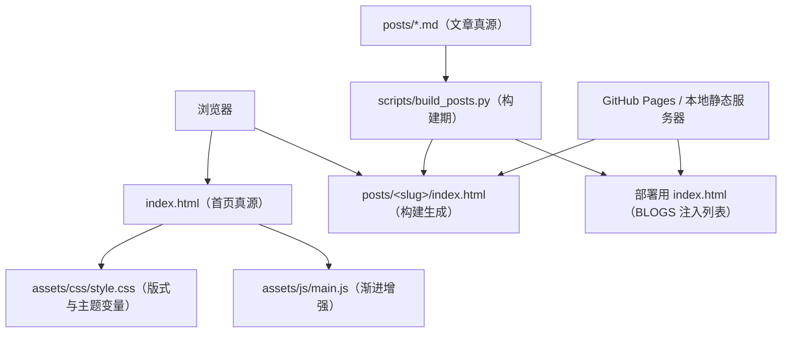

# 个人博客系统总体设计

> **created**: 2026-11-06 ｜ **last-change**: 2026-11-08 ｜ **status**: baseline

## 1. 简介

本设计把仓库从「静态文档站」改版为个人博客。站点以少量长期维护的文本为核心，采用单页首页承载引文与项目两个层次，视觉上借鉴 [egoist.dev](https://egoist.dev/) 的极简叙事：36rem 单栏、弱化装饰，以留白与卡片组织内容。

当前状态为 **baseline**：设计已获人类确认并作为现行基线；首页随 T01 交付，博客文章体系（md 源码、文章页与首页列表注入）随 T02 交付，详见 [博客文章设计方案](02-博客文章.md)。

## 2. 索引

- 文档 ID：DESIGN-OVERVIEW
- 对应主题：BlogSite
- 下级设计：[博客首页](01-博客首页.md)、[博客文章](02-博客文章.md)
- 执行记录：[变更总账 (BlogSite)](../change/index.json#BlogSite)

## 3. 规范

### 3.1 目标

1. 用最少的技术面交付一个可直接托管、可直接打开的博客首页；
2. 排版以中文宋体与西文 Times New Roman 为核心，形成稳定的编辑风视觉；
3. 内容结构可扩展：后续新增独立页面或项目条目时无需重写首页骨架；
4. 保持零追踪、零第三方运行时依赖，降低长期维护成本。

### 3.2 非目标

- 不实现内容管理系统、评论、搜索或服务端渲染；
- 不引入前端框架、CSS 预处理器或打包器；
- 不在本次改版中恢复旧的 Hugo 文档站结构、主题与内容流水线；
- 不承诺跨浏览器像素级一致，仅保证现代浏览器下的排版与可用性。

### 3.3 约束

- 托管环境为 GitHub Pages；由 `main` 分支的 GitHub Actions workflow 先跑治理校验、再执行文章构建（`scripts/build_posts.py`，构建期依赖仅 `markdown` 与 `pygments`），将构建产物上传为 Pages artifact 发布；
- 页面必须能在 `file://` 与 HTTP 两种加载方式下正常工作；
- 字体只使用系统可用的宋体与 Times New Roman 字族，不下载 Web Font；
- 站点不得包含 secrets、内网地址或追踪脚本。

## 4. 设计详情

### 4.1 架构与行为

站点是「内容源 + 样式 + 渐进增强脚本」的静态结构：首页与文章页均无运行期服务，文章页由**部署期的一次构建**从 Markdown 源生成（产物不入库，见 [博客文章](02-博客文章.md)）。

- `index.html` 承载首页全部可见内容与语义结构，仓库内 BLOGS 区块保持空状态，列表仅在构建副本中注入；
- `posts/*.md` 是文章唯一真源，构建脚本同时复制 `assets/` 并透传 `?v=` 缓存版本；
- `style.css` 通过 CSS 自定义属性集中管理字体、色板、间距与暗色模式；
- `main.js` 只做可选增强：主题切换与记忆、版权年份、搜索占位、首页轮播/回顶/引文；脚本失败或禁用时内容完整可读；
- 除部署期构建外无其他构建步骤，不存在入库的产物目录与依赖锁文件。

### 4.2 核心业务规则

<!-- @topic: BlogSite -->

1. **内容优先**：首屏必须在不执行 JavaScript 的情况下完整呈现；脚本失败或禁用时只损失动效与年份更新。
2. **单一发布源**：站点只有一套现行实现，根目录 `index.html` 即首页真源；不为兼容旧站点保留并行入口。
3. **字体契约**：中文使用宋体族，拉丁字母与数字使用 Times New Roman；字体栈顺序固定，缺字时按声明顺序回落。
4. **浅/深双主题**：首次加载自动匹配浏览器深浅偏好；手动切换后记住选择；只提供浅色与深色两态，不设跟随系统按钮。
5. **可访问性基线**：语义化 landmark、跳转链接、可见焦点、足够对比度，以及 `prefers-reduced-motion` 下的静态终态。
6. **零运行时外部依赖**：浏览器不请求第三方 CDN、字体、统计或图标库，图标以内联字符或 SVG 表达；`markdown` 与 `pygments` 仅为构建期依赖，只在部署与本地预览时使用，不进入运行时。

### 4.3 验证与实现情况

- 首页骨架、样式系统与渐进增强脚本已随 T01 交付并上线；博客文章体系（构建脚本、文章页与首页列表注入）随 T02 交付，验证以 `node tests/posts.test.cjs` 为准；
- 结构与流程检查以 `scripts/adflow-verify --mode init` 与 `scripts/adflow-verify` 为准，二者都不能证明视觉验收；
- 视觉验收需在 1440px 与 390px 两个视口人工确认，浅色/深色主题表现与减少动态效果需单独复核；
- 范围外：RSS/订阅、评论与标签归档不交付；顶栏搜索仍为 UI 占位，不提供全文搜索。

### 4.4 规则演进

| 编号 | 类型 | 简介 | 规则演进 |
|---|---|---|---|
| [T02](../task/T02.json) | Task | 引入部署期文章构建 | 站点从纯静态单页扩展为「md 源码 + 部署期构建」；运行时仍零依赖，产物不入库 |

### 4.5 参考资料

- [egoist.dev](https://egoist.dev/)：36rem 单栏、小型顶栏与双列项目卡片的版式参考；
- 仓库改版前实现（提交 `7316e07`）：Hugo + Hextra 文档站，本设计明确不继承其结构；
- 浏览器对 `prefers-reduced-motion` 与 CSS 字体回落的支持现状。
