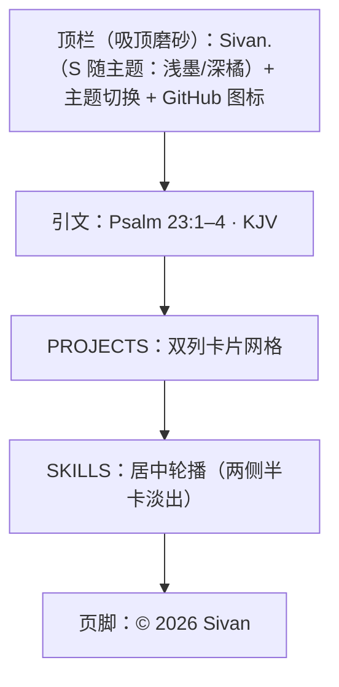

# 博客首页设计方案

> **created**: 2026-11-06 ｜ **last-change**: 2026-11-06 ｜ **status**: baseline

## 1. 简介

首页采用 [egoist.dev](https://egoist.dev/) 的紧凑布局：36rem 单栏、小型顶栏、一段 KJV 引文、双列项目卡片、紧凑页脚。视觉上保留「纸上排印」的取向——杏色纸面、墨色文字、宋体承担中文骨架、Times New Roman 承担拉丁字母与数字。

与 egoist.dev 的差异：不设写作归档与个人自述，只保留身份、项目与页脚；项目卡片不显示技术标签，图标混合真实应用图标与线性符号。

## 2. 索引

- 文档 ID：DESIGN-HOME
- 所属总体：[系统总体设计](00-系统总体设计.md)
- 对应主题：BlogHome
- 执行记录：[变更总账 (BlogHome)](../change/index.json#BlogHome)

## 3. 规范

### 3.1 信息结构

自上而下六个区块，顺序固定：

1. **顶栏**：字标 `Sivan.`（浅色模式 S 为墨色、其余为次级灰；深色模式 S 为强调橘色、其余为墨色；粗体）+ 搜索（默认放大镜，点击展开纸面填充搜索栏）+ 主题切换按钮 + GitHub 图标；滚动时吸顶，纸面色到透明的渐变遮罩；不显示分隔线；
2. **引文**：KJV 诗篇 23:1–4，Times New Roman 斜体，附版本出处；默认折叠，点击字标切换展开/收起；
3. **PROJECTS**：两张项目卡片（Bruce / oh-my-tab）组成双列网格，均使用真实图标；
4. **SKILLS**：ad-flow、knowledge-map、test-anything 三张与项目卡等宽的技能卡组成居中轮播，中间一张完整卡，两侧各露出约半张并淡出；点击左右半卡切换，循环播放；
5. **BLOGS**：暂无文章时显示羽毛笔图标 + `COMING SOON` 的空状态，不设链接、不使用虚线卡片框；有文章后替换为文章列表；
6. **页脚**：仅版权行 `© 2026 Sivan`，水平居中；浅色为次级灰、深色为强调橘色；页面底部留白 24px。

页面另有两层垂直居中的字符画底图，分别贴在视口左右边缘只露出内侧一半（左侧再右移一个字符宽）：左侧为鸢尾花，右侧为带翼人像；它们固定在视口内、位于全部内容之后，不参与信息层级。浅色模式为低对比棕色、深色模式为与字标 S 相同的强调橘色。

### 3.2 字体契约

```css
--font-serif: "Times New Roman", "Songti SC", "STSong", "SimSun",
  "Noto Serif CJK SC", "Source Han Serif SC", serif;
```

- 拉丁字母与数字优先命中 Times New Roman；
- 中文继续回落至宋体族，形成「西文 Times + 中文宋体」的混排；
- 不加载 Web Font，不做字体子集化；
- 正文 15px / 1.7；引文 16–18px（Times 斜体，独立于中文正文）；项目卡与技能卡名称 15px / 500、说明 14px；导航与页脚 13px；
- 字标使用 16px / 700；浅色模式 S 为墨色、其余为次级灰（与主题按钮未选中色一致）；深色模式 S 为强调橘色、其余为墨色；作为页面唯一的 h1。

### 3.3 版式与间距

以 egoist.dev 的 `max-w-page: 36rem` 为基准，内容列约 536px。

| 令牌 | 值 | 用途 |
|---|---|---|
| `--measure` | 36rem | 页面最大宽度（含 20px 内边距） |
| 页面内边距 | `0 20px 64px` | 顶栏独立吸顶，主体从顶栏下方开始 |
| 顶栏 | 全宽吸顶，内容对齐 36rem 列；纸面色到透明的渐变遮罩 | 无分隔线 |
| 顶栏搜索 | 收起 28×28；展开 180×28，纸面填充、8px 圆角；窄屏 150 / 144 | 顶栏 |
| 页脚 | 页面底部留白 24px，水平居中；浅色次级灰、深色强调橘色 | 与主体分离 |
| 引文 | 顶部间距 40–64px，最大 30rem，左侧发丝线 | 英文 KJV，Times 斜体 |
| 区块间距 | 64px | 引文到项目、项目到 SKILLS |
| 卡片网格 | 1 列（窄屏）/ 2 列（≥640px），间距 10px | 项目区 |
| 卡片 | 圆角 12px、内边距 14–16px；图标与标题同行，描述在下 | 项目与技能卡片 |
| 技能卡 | 与项目卡同宽（宽屏 263px / 窄屏按视口收窄）；中间一张完整、两侧各露出约半张；切换间距 10px；两侧 40px / 18px 渐隐 | SKILLS 区 |
| 图标 | 32px，圆角 7px | 卡片图标 |
| 页脚 | 固定在视口底部，水平居中，底部留白 24px；页面底部预留 96px | 与主体分离 |
| 字符画底图 | 视口垂直居中、左右缘半露（左侧再右移 1ch），随视口缩放（1440px 右侧约 562×528、左侧约 441×528） | 页面背景 |
| BLOGS 空状态 | 区块间距 64px；羽毛笔 22px（无边框）；占位顶部内边距 24px；文案 11px / 0.2em 字距 | BLOGS 区块 |

### 3.4 色板

页面首次加载自动匹配浏览器的浅色/深色偏好；手动切换后记住选择，仅浅色与深色两态，不提供跟随系统按钮。浅色为杏色纸面，深色为暖黑纸面；强调色在深色下提亮为 `#d9855f`。

| 令牌 | 浅色 | 深色 | 用途 |
|---|---|---|---|
| `--paper` | `#f7e5d1` | `#17130f` | 页面底色 |
| `--paper-raise` | `#fcf1e2` | `#211b16` | 卡片底色 |
| `--ink` | `#211a15` | `#ece4d8` | 主文字 |
| `--ink-soft` | `#5d5045` | `#b5a898` | 说明文字 |
| `--ink-faint` | `#6f6054` | `#8c7f70` | 导航、区块标题、页脚 |
| `--rule` | `rgba(33,26,21,.15)` | `rgba(236,228,216,.16)` | 卡片与图标边框 |
| `--accent` | `#9b3a24` | `#d9855f` | 字标 S、焦点环 |
| `--accent-soft` | `rgba(155,58,36,.38)` | `rgba(217,133,95,.42)` | 卡片悬停边框 |

`color-scheme` 随 `data-theme` 切换为 `light` 或 `dark`；`theme-color` 同步为对应底色。无 JavaScript 时回退为浅色。

### 3.5 交互

- **项目卡片与技能卡片**：指针位置驱动柔光，卡片上浮 3px、轻微放大 1%，边框转为朱砂色，图标上移 2px 并旋转 3°；480ms 弹性缓动；
- **顶栏吸顶**：滚动时固定在顶部，背景为纸面色到透明的渐变遮罩；不显示分隔线，滚动时也不出现；
- **顶栏 GitHub 图标**：颜色由次级色过渡到主文字色；
- **入场**：PROJECTS、SKILLS、BLOGS、页脚从上到下依次淡入并上移 12px，间隔 80ms，单段 600ms；顶栏不参与动画；不随 reduced-motion 关闭；
- **技能轮播**：中间一张完整卡，左右各露出约半张并淡出；直接点击左右半卡切换（无独立箭头按钮），左侧回到上一张（轨道向右过渡），右侧前进（轨道向左过渡），单步 600ms；动画期间的再次点击计入目标索引并合并为一次连续过渡（600–900ms），不丢弃点击；越过末张后在动画结束瞬间完成无缝回绕；只有真正居中的中间副本卡片按普通链接打开，其余点击一律翻页；技能轮播由用户主动触发，始终保留滑动，不受 reduced-motion 禁用；
- **字符画底图**：两幅字符画固定在视口垂直居中，分别贴在左右边缘只露出内侧一半（左侧再右移一个字符宽 1ch）；左鸢尾花、右带翼人像；两幅同字号、同 44 行高，随视口缩放；浅色模式用棕色符号、深色模式用与字标 S 相同的强调橘色绘制；`pointer-events: none`，不拦截点击、选择或键盘焦点；打印时隐藏；
- **BLOGS 空状态**：没有文章时显示居中的 22px 羽毛笔线稿与 `COMING SOON`，无边框、无卡片框；占位整体下移（顶部内边距 24px）；
- **页脚**：页脚保持在文档流末尾，页面底部留白 24px；滚动到底部时自然贴底，不常驻视口；浅色为次级灰、深色为强调橘色；
- **字标回顶**：点击字标以 460ms ease-out 缓动滚回顶部，并更新 `#top` 哈希；同时切换默认折叠的引文；不随 reduced-motion 变为瞬时跳转；
- **引文折叠**：引文默认折叠，页面从 PROJECTS 开始；点击字标切换：折叠时展开并滚回顶部，展开时收起并回到 PROJECTS；折叠时无法向上滚动到引文；
- **主题切换**：GitHub 图标左侧的太阳/月亮按钮，仅切换浅色/深色；首次加载读取浏览器偏好，手动选择写入 `localStorage`；系统偏好变化仅在无手动选择时跟随；点击后以按钮中心为圆心，用 View Transitions API 的圆形 `clip-path` 扩散 600ms 揭示新主题，不支持该 API 时瞬时切换；太阳/月亮图标以 420ms 旋转 + 淡入淡出独立切换。
- **顶栏搜索**：默认 28px 放大镜，与主题按钮的视觉间距和主题/GitHub 间距一致；点击展开 180×28 纸面填充搜索栏（8px 圆角），输入文字使用主题衬线字体与墨色；⌘F/Ctrl+F 切换展开/收起，Esc/点击外部收起；窄屏展开宽度收窄；

### 3.6 响应式与可访问性

- 断点 `640px`：窄屏卡片单列、宽屏双列；两种宽度下均为图标与标题同行、描述横跨下方；SKILLS 为居中轮播，两侧半卡在 640px 以下随视口收窄；卡片悬停、技能轮播、主题扩散、引文展开、字标回顶与页面入场始终保留过渡；其余动效遵循 reduced-motion；
- 最小支持宽度 320px，任何视口不得出现横向滚动；
- 语义结构：`header/nav/main/section/footer`，h1 为字标，h2 为项目与 SKILLS 标题；
- 跳转链接、`aria-label`、装饰图标 `aria-hidden`、2px 焦点环；
- 字符画底图标记为 `aria-hidden="true"`，不进入辅助技术阅读顺序，也不参与 Tab 焦点；
- 搜索栏收起时输入框 `tabindex="-1"` 且内容 `aria-hidden`，展开后恢复；放大镜按钮用 `aria-expanded` 表达状态；
- 全站隐藏浏览器滚动栏（`scrollbar-width: none` 与 `::-webkit-scrollbar`），保留滚轮、触控板与键盘滚动；
- 浅色与深色两套主题的文字对比度均不低于 WCAG AA；主题按钮有 `aria-label`/`title`，图标为装饰元素，名称同时以文本呈现；
- 打印样式：隐藏顶栏导航，卡片避免跨页断开。

## 4. 设计详情

### 4.1 架构与行为



页面自顶向下阅读，区块之间只靠留白分隔；项目卡片是唯一的容器样式，其余元素不使用卡片、边框或阴影。

### 4.2 核心业务规则

<!-- @topic: BlogHome -->

1. **36rem 单栏**：内容列固定为 36rem，宽屏居中留白，不随视口拉伸；
2. **双列卡片**：≥640px 时项目卡片两列等宽，窄屏单列；卡片内图标与标题同行、描述在下；
3. **数字归 Times**：年份、版权等数字使用 Times New Roman，作为版面的西文骨架；
4. **留白即分隔**：区块之间不画分隔线，卡片自身承担边界；
5. **动效克制**：微交互只允许位移、透明度与轻微缩放，时长 180–600ms；技能轮播单步 600ms、连续点击合并时不超过 900ms，卡片悬停 480ms 弹性缓动（均为用户主动触发，不随 reduced-motion 关闭）；
6. **内容可替换**：全部项目与技能卡均链接真实仓库；替换名称、说明、链接后版式不得塌陷；
7. **禁用 JS 仍完整**：默认样式即终态，`js` 类只在脚本成功执行后由内联脚本添加；
8. **浅/深双主题**：首次加载匹配浏览器偏好；手动切换后记住选择；只提供浅色与深色两态，不设跟随系统按钮；切换时以按钮为圆心扩散更新整页配色；主题按钮图标以旋转 + 淡入淡出切换；
9. **项目与技能分区**：PROJECTS 区放产品与工具，SKILLS 区放可复用的 Agent 技能；技能卡与项目卡等宽，组成居中轮播，左右半卡用于切换，三份副本用于无缝循环；回绕只在动画结束后瞬时完成，不得在动画中途吸附；
10. **引文归 Times**：英文圣经引文显式使用 Times New Roman 斜体并标注版本；中文正文仍回落宋体，不复用引文字体；
11. **顶栏吸顶**：滚动时固定在顶部，使用纸面色到透明的渐变遮罩；不显示分隔线。
12. **字符画底图**：两幅垂直居中、分别贴在视口左右边缘只露出内侧一半的字符画（左侧再右移一个字符宽；左鸢尾花、右带翼人像）作为常驻背景，浅色低对比棕色、深色与字标 S 相同的强调橘色；不拦截交互、不进入可访问性树，打印时隐藏；
13. **滚动栏隐藏**：全站隐藏浏览器滚动栏，但保留滚轮、触控板与键盘滚动；不改变文档高度与滚动范围；
14. **BLOGS 空状态**：没有文章时在 SKILLS 与页脚之间显示羽毛笔图标 + `COMING SOON`，不设链接、不使用虚线卡片框；有文章后替换为文章列表；
15. **页脚贴底**：页脚保持在文档流末尾，页面底部留白 24px；不固定到视口；浅色为次级灰、深色为强调橘色；
16. **字标回顶**：点击字标以 460ms 缓动滚回顶部并更新 `#top` 哈希；同时切换默认折叠的引文；不随 reduced-motion 变为瞬时跳转；
17. **引文折叠**：引文默认折叠，页面从 PROJECTS 开始且不能向上滚动到引文；点击字标切换：折叠时展开并回到顶部，展开时收起并回到 PROJECTS；
18. **入场动画**：页面加载时 PROJECTS、SKILLS、BLOGS、页脚从上到下依次淡入并上移 12px，间隔 80ms，单段 600ms；顶栏不参与动画；不随 reduced-motion 关闭；
19. **顶栏搜索**：默认收缩为放大镜，展开为纸面填充搜索栏，输入文字使用主题衬线字体与墨色；⌘F/Ctrl+F 切换展开/收起；Esc/点击外部收起；收起态图标与主题按钮间距和主题/GitHub 间距一致；窄屏不产生横向滚动。

### 4.3 验证与实现情况

- 已实现：浅/深主题切换、吸顶渐变顶栏（无分隔线）、KJV 引文、双列项目卡片、SKILLS 居中轮播、紧凑页脚、渐进增强脚本；
- 结构检查：`scripts/adflow-verify --mode init` 与 `scripts/adflow-verify`；
- 轮播回归：`node tests/carousel.test.cjs` 覆盖翻页时序、连续点击、回绕与点击判定，1440px 与 390px 视口均通过；
- 底图回归：`node tests/page-art.test.cjs` 覆盖存在性、居中、主题配色、交互隔离与打印隐藏，1440px 与 390px 视口均通过；
- 主题回归：`node tests/theme.test.cjs` 覆盖字标配色、扩散动画调用、图标切换与降级；
- 滚动回归：`node tests/scroll.test.cjs` 覆盖滚动栏隐藏、纵向滚动保留与无横向滚动；
- BLOGS 回归：`node tests/blogs.test.cjs` 覆盖区块顺序、标题、羽毛笔图标、COMING SOON、无链接与主题配色；
- 页脚回归：`node tests/footer.test.cjs` 覆盖页脚流式位置、底部留白、主题配色与顶栏渐变/无分隔线；
- 卡片回归：`node tests/card-layout.test.cjs` 覆盖图标标题同行、描述横跨与 1440/390 响应式；
- 字标回归：`node tests/wordmark-scroll.test.cjs` 覆盖 reduced-motion 下的平滑回顶、哈希更新与无重载；
- 引文回归：`node tests/verse-panel.test.cjs` 覆盖默认折叠、PROJECTS 首屏、字标切换与回顶；
- 入场回归：`node tests/intro.test.cjs` 覆盖 4 段动画、延迟递增与结束不透明度；
- 搜索回归：`node tests/search.test.cjs` 覆盖收起/展开、快捷键、深浅色与 390/320 窄屏；
- 视觉检查：1440px 与 390px 视口全页截图核对（浅色、深色、禁用 JS、减少动态效果四种状态）；
- 范围外：写作与文章能力整体移除，不保留文章列表、详情页或 RSS；全部项目与技能卡已接真实链接；
- 风险：不同平台宋体字面差异较大（Songti SC / SimSun / 思源宋体），卡片内的行长与字重可能略有差异。

### 4.4 规则演进

| 编号 | 类型 | 简介 | 规则演进 |
|---|---|---|---|
| [C001](../change/C001.json) | BugFix | 修复 SKILLS 技能轮播翻页卡顿与连续点击丢失 | 翻页动画改由 Web Animations API 驱动，不再监听 transitionend；连续点击合并为一次连续过渡；回绕仅在动画结束后完成；卡片宽度取布局宽度，居中判定收紧到 3px |
| [C002](../change/C002.json) | Enhancement | 首页左右半露字符画背景层 | 新增左右两幅半露字符画（左鸢尾花、右带翼人像，左侧再右移 1ch），同字号、同 44 行高；浅色棕色、深色与字标 S 相同的强调橘色；pointer-events: none、aria-hidden、打印隐藏 |
| [C003](../change/C003.json) | Enhancement | 浅色字标配色与主题扩散切换动画 | 浅色模式 S 改墨色、ivan. 改次级灰；深色保持 S 强调橘色；主题切换以按钮为圆心 600ms 圆形扩散；不支持 View Transitions 时瞬时切换 |
| [C004](../change/C004.json) | Enhancement | 隐藏页面滚动栏 | 全站隐藏浏览器滚动栏，保留滚轮、触控板与键盘滚动；文档高度与滚动范围不变 |
| [C005](../change/C005.json) | Feature | 首页新增 BLOGS 空状态占位 | SKILLS 与页脚之间新增 BLOGS 区块；22px 羽毛笔线稿 + COMING SOON，无边框、无链接 |
| [C006](../change/C006.json) | Enhancement | 页脚贴底与顶栏渐变遮罩 | 页脚回到文档流，滚动到底部时贴底，页面底部留白 24px；顶栏改用纸面色渐变遮罩并移除分隔线 |
| [C007](../change/C007.json) | Enhancement | 主题切换图标动画 | 太阳/月亮图标始终渲染，420ms 旋转 + 淡入淡出；独立 view-transition 关键帧与整页扩散同时进行 |
| [C008](../change/C008.json) | Enhancement | 页脚主题配色 | 页脚版权行浅色为次级灰、深色为强调橘色 |
| [C009](../change/C009.json) | Enhancement | 卡片图标标题同行布局 | 项目卡与技能卡统一为图标与标题同行、描述横跨下方；窄屏单列、宽屏双列 |
| [C010](../change/C010.json) | Enhancement | 字标点击平滑回顶 | 点击字标以 460ms 缓动滚回顶部并更新 #top 哈希；reduced-motion 下不再瞬时跳转 |
| [C011](../change/C011.json) | Feature | 引文默认折叠与字标切换 | 引文默认折叠，页面从 PROJECTS 开始；点击字标切换展开/收起，展开时滑回顶部 |
| [C012](../change/C012.json) | Enhancement | 页面打开入场动画 | PROJECTS、SKILLS、BLOGS、页脚从上到下依次淡入上移，间隔 80ms；顶栏不参与；不随 reduced-motion 关闭 |
| [C013](../change/C013.json) | Feature | 顶栏搜索栏 | 主题按钮左侧新增搜索：默认 28px 放大镜（间距与主题/GitHub 一致），展开 180×28 纸面填充；输入文字与主题字体/墨色一致；⌘F/Ctrl+F 切换；窄屏收窄 |

### 4.5 参考资料

- [egoist.dev](https://egoist.dev/)：36rem 单栏、小型顶栏、双列项目卡片与紧凑页脚；
- King James Version（公有领域）：首页 Psalm 23:1–4 引文；
- `index.html`、`assets/css/style.css`、`assets/js/main.js`：本文对应的实现文件；
- `assets/bruce-icon.png`：Bruce 应用图标，取自 https://4eversivan.github.io/Bruce/assets/bruce-icon.png；
- `assets/oh-my-tab-icon.png`：oh-my-tab 图标，取自 https://github.com/4everSivan/oh-my-tab/blob/main/docs/assets/logo-rounded.png。
