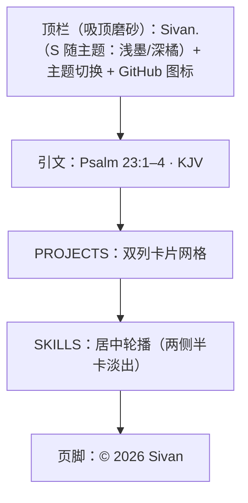

# 博客首页设计方案

> **created**: 2026-11-06 ｜ **last-change**: 2026-11-06 ｜ **status**: baseline

## 1. 简介

首页采用 [egoist.dev](https://egoist.dev/) 的紧凑布局：36rem 单栏、小型顶栏、一段 KJV 引文、双列项目卡片、紧凑页脚。视觉上保留「纸上排印」的取向——杏色纸面、墨色文字、宋体承担中文骨架、Times New Roman 承担拉丁字母与数字。

与 egoist.dev 的差异：不设写作归档与个人自述，只保留身份、项目与页脚；项目卡片不显示技术标签，图标混合真实应用图标与线性符号。

## 2. 索引

- 文档 ID：DESIGN-HOME
- 所属总体：[系统总体设计](00-系统总体设计.md)
- 对应主题：BlogHome
- 执行记录：[变更总账 (BlogHome)](../change/index.json#BlogHome)

## 3. 规范

### 3.1 信息结构

自上而下五个区块，顺序固定：

1. **顶栏**：字标 `Sivan.`（浅色模式 S 为墨色、其余为次级灰；深色模式 S 为强调橘色、其余为墨色；粗体）+ 主题切换按钮 + GitHub 图标；滚动时吸顶，半透明纸面色磨砂背景；顶部无分界线，滚动后渐显；
2. **引文**：KJV 诗篇 23:1–4，Times New Roman 斜体，附版本出处；
3. **PROJECTS**：两张项目卡片（Bruce / oh-my-tab）组成双列网格，均使用真实图标；
4. **SKILLS**：ad-flow、knowledge-map、test-anything 三张与项目卡等宽的技能卡组成居中轮播，中间一张完整卡，两侧各露出约半张并淡出；点击左右半卡切换，循环播放；
5. **页脚**：仅版权行 `© 2026 Sivan`，水平居中。

页面另有两层垂直居中的字符画底图，分别贴在视口左右边缘只露出内侧一半（左侧再右移一个字符宽）：左侧为鸢尾花，右侧为带翼人像；它们固定在视口内、位于全部内容之后，不参与信息层级。浅色模式为低对比棕色、深色模式为与字标 S 相同的强调橘色。

### 3.2 字体契约

```css
--font-serif: "Times New Roman", "Songti SC", "STSong", "SimSun",
  "Noto Serif CJK SC", "Source Han Serif SC", serif;
```

- 拉丁字母与数字优先命中 Times New Roman；
- 中文继续回落至宋体族，形成「西文 Times + 中文宋体」的混排；
- 不加载 Web Font，不做字体子集化；
- 正文 15px / 1.7；引文 16–18px（Times 斜体，独立于中文正文）；项目卡与技能卡名称 15px / 500、说明 14px；导航与页脚 13px；
- 字标使用 16px / 700；浅色模式 S 为墨色、其余为次级灰（与主题按钮未选中色一致）；深色模式 S 为强调橘色、其余为墨色；作为页面唯一的 h1。

### 3.3 版式与间距

以 egoist.dev 的 `max-w-page: 36rem` 为基准，内容列约 536px。

| 令牌 | 值 | 用途 |
|---|---|---|
| `--measure` | 36rem | 页面最大宽度（含 20px 内边距） |
| 页面内边距 | `0 20px 64px` | 顶栏独立吸顶，主体从顶栏下方开始 |
| 顶栏 | 全宽吸顶，内容对齐 36rem 列；64% 纸面色 + 18px 模糊 | 顶部无分界线，滚动 >24px 渐显 1px 发丝线 |
| 引文 | 顶部间距 40–64px，最大 30rem，左侧发丝线 | 英文 KJV，Times 斜体 |
| 区块间距 | 64px | 引文到项目、项目到 SKILLS |
| 卡片网格 | 1 列（窄屏）/ 2 列（≥640px），间距 10px | 项目区 |
| 卡片 | 圆角 12px、内边距 14–16px、最小高度 152px | 项目卡片 |
| 技能卡 | 与项目卡同宽（宽屏 263px / 窄屏按视口收窄）；中间一张完整、两侧各露出约半张；切换间距 10px；两侧 40px / 18px 渐隐 | SKILLS 区 |
| 图标 | 32px，圆角 7px | 卡片图标 |
| 页脚 | 顶部间距 112px，水平居中 | 与主体分离 |
| 字符画底图 | 视口垂直居中、左右缘半露（左侧再右移 1ch），随视口缩放（1440px 右侧约 562×528、左侧约 441×528） | 页面背景 |

### 3.4 色板

页面首次加载自动匹配浏览器的浅色/深色偏好；手动切换后记住选择，仅浅色与深色两态，不提供跟随系统按钮。浅色为杏色纸面，深色为暖黑纸面；强调色在深色下提亮为 `#d9855f`。

| 令牌 | 浅色 | 深色 | 用途 |
|---|---|---|---|
| `--paper` | `#f7e5d1` | `#17130f` | 页面底色 |
| `--paper-raise` | `#fcf1e2` | `#211b16` | 卡片底色 |
| `--ink` | `#211a15` | `#ece4d8` | 主文字 |
| `--ink-soft` | `#5d5045` | `#b5a898` | 说明文字 |
| `--ink-faint` | `#6f6054` | `#8c7f70` | 导航、区块标题、页脚 |
| `--rule` | `rgba(33,26,21,.15)` | `rgba(236,228,216,.16)` | 卡片与图标边框 |
| `--accent` | `#9b3a24` | `#d9855f` | 字标 S、焦点环 |
| `--accent-soft` | `rgba(155,58,36,.38)` | `rgba(217,133,95,.42)` | 卡片悬停边框 |

`color-scheme` 随 `data-theme` 切换为 `light` 或 `dark`；`theme-color` 同步为对应底色。无 JavaScript 时回退为浅色。

### 3.5 交互

- **项目卡片与技能卡片**：指针位置驱动柔光，卡片上浮 3px、轻微放大 1%，边框转为朱砂色，图标上移 2px 并旋转 3°；480ms 弹性缓动；
- **顶栏吸顶**：滚动时固定在顶部，背景为 64% 纸面色（浅色杏色 / 深色暖黑）+ 18px 背景模糊（`saturate(1.15)`）；顶部不显示分界线，滚动超过 24px 后以 320ms 过渡渐显底部发丝线；
- **顶栏 GitHub 图标**：颜色由次级色过渡到主文字色；
- **入场**：主体整体上移 10px + 淡入，时长 600ms；
- **技能轮播**：中间一张完整卡，左右各露出约半张并淡出；直接点击左右半卡切换（无独立箭头按钮），左侧回到上一张（轨道向右过渡），右侧前进（轨道向左过渡），单步 600ms；动画期间的再次点击计入目标索引并合并为一次连续过渡（600–900ms），不丢弃点击；越过末张后在动画结束瞬间完成无缝回绕；只有真正居中的中间副本卡片按普通链接打开，其余点击一律翻页；技能轮播由用户主动触发，始终保留滑动，不受 reduced-motion 禁用；
- **字符画底图**：两幅字符画固定在视口垂直居中，分别贴在左右边缘只露出内侧一半（左侧再右移一个字符宽 1ch）；左鸢尾花、右带翼人像；两幅同字号、同 44 行高，随视口缩放；浅色模式用棕色符号、深色模式用与字标 S 相同的强调橘色绘制；`pointer-events: none`，不拦截点击、选择或键盘焦点；打印时隐藏；
- **主题切换**：GitHub 图标左侧的太阳/月亮按钮，仅切换浅色/深色；首次加载读取浏览器偏好，手动选择写入 `localStorage`；系统偏好变化仅在无手动选择时跟随；点击后以按钮中心为圆心，用 View Transitions API 的圆形 `clip-path` 扩散 600ms 揭示新主题，不支持该 API 时瞬时切换。

### 3.6 响应式与可访问性

- 断点 `640px`：窄屏卡片为单列横向布局（图标在左），宽屏为双列纵向布局（图标在上）；SKILLS 为居中轮播，两侧半卡在 640px 以下随视口收窄；卡片悬停、技能轮播与主题扩散由用户主动触发，始终保留过渡；其余动效遵循 reduced-motion；
- 最小支持宽度 320px，任何视口不得出现横向滚动；
- 语义结构：`header/nav/main/section/footer`，h1 为字标，h2 为项目与 SKILLS 标题；
- 跳转链接、`aria-label`、装饰图标 `aria-hidden`、2px 焦点环；
- 字符画底图标记为 `aria-hidden="true"`，不进入辅助技术阅读顺序，也不参与 Tab 焦点；
- 浅色与深色两套主题的文字对比度均不低于 WCAG AA；主题按钮有 `aria-label`/`title`，图标为装饰元素，名称同时以文本呈现；
- 打印样式：隐藏顶栏导航，卡片避免跨页断开。

## 4. 设计详情

### 4.1 架构与行为



页面自顶向下阅读，区块之间只靠留白分隔；项目卡片是唯一的容器样式，其余元素不使用卡片、边框或阴影。

### 4.2 核心业务规则

<!-- @topic: BlogHome -->

1. **36rem 单栏**：内容列固定为 36rem，宽屏居中留白，不随视口拉伸；
2. **双列卡片**：≥640px 时项目卡片两列等宽，窄屏回到单列横向卡片；
3. **数字归 Times**：年份、版权等数字使用 Times New Roman，作为版面的西文骨架；
4. **留白即分隔**：区块之间不画分隔线，卡片自身承担边界；
5. **动效克制**：微交互只允许位移、透明度与轻微缩放，时长 180–600ms；技能轮播单步 600ms、连续点击合并时不超过 900ms，卡片悬停 480ms 弹性缓动（均为用户主动触发，不随 reduced-motion 关闭）；
6. **内容可替换**：全部项目与技能卡均链接真实仓库；替换名称、说明、链接后版式不得塌陷；
7. **禁用 JS 仍完整**：默认样式即终态，`js` 类只在脚本成功执行后由内联脚本添加；
8. **浅/深双主题**：首次加载匹配浏览器偏好；手动切换后记住选择；只提供浅色与深色两态，不设跟随系统按钮；切换时以按钮为圆心扩散更新整页配色；
9. **项目与技能分区**：PROJECTS 区放产品与工具，SKILLS 区放可复用的 Agent 技能；技能卡与项目卡等宽，组成居中轮播，左右半卡用于切换，三份副本用于无缝循环；回绕只在动画结束后瞬时完成，不得在动画中途吸附；
10. **引文归 Times**：英文圣经引文显式使用 Times New Roman 斜体并标注版本；中文正文仍回落宋体，不复用引文字体；
11. **顶栏吸顶**：滚动时固定在顶部，使用半透明纸面色与背景模糊；顶部隐藏分界线，滚动超过 24px 后渐显底部发丝线；不支持模糊时提高背景不透明度；
12. **字符画底图**：两幅垂直居中、分别贴在视口左右边缘只露出内侧一半的字符画（左侧再右移一个字符宽；左鸢尾花、右带翼人像）作为常驻背景，浅色低对比棕色、深色与字标 S 相同的强调橘色；不拦截交互、不进入可访问性树，打印时隐藏。

### 4.3 验证与实现情况

- 已实现：浅/深主题切换、吸顶磨砂顶栏（滚动渐显分界线）、KJV 引文、双列项目卡片、SKILLS 居中轮播、紧凑页脚、渐进增强脚本；
- 结构检查：`scripts/adflow-verify --mode init` 与 `scripts/adflow-verify`；
- 轮播回归：`node tests/carousel.test.cjs` 覆盖翻页时序、连续点击、回绕与点击判定，1440px 与 390px 视口均通过；
- 底图回归：`node tests/page-art.test.cjs` 覆盖存在性、居中、主题配色、交互隔离与打印隐藏，1440px 与 390px 视口均通过；
- 主题回归：`node tests/theme.test.cjs` 覆盖字标配色、扩散动画调用与降级；
- 视觉检查：1440px 与 390px 视口全页截图核对（浅色、深色、禁用 JS、减少动态效果四种状态）；
- 范围外：写作与文章能力整体移除，不保留文章列表、详情页或 RSS；全部项目与技能卡已接真实链接；
- 风险：不同平台宋体字面差异较大（Songti SC / SimSun / 思源宋体），卡片内的行长与字重可能略有差异。

### 4.4 规则演进

| 编号 | 类型 | 简介 | 规则演进 |
|---|---|---|---|
| [C001](../change/C001.json) | BugFix | 修复 SKILLS 技能轮播翻页卡顿与连续点击丢失 | 翻页动画改由 Web Animations API 驱动，不再监听 transitionend；连续点击合并为一次连续过渡；回绕仅在动画结束后完成；卡片宽度取布局宽度，居中判定收紧到 3px |
| [C002](../change/C002.json) | Enhancement | 首页左右半露字符画背景层 | 新增左右两幅半露字符画（左鸢尾花、右带翼人像，左侧再右移 1ch），同字号、同 44 行高；浅色棕色、深色与字标 S 相同的强调橘色；pointer-events: none、aria-hidden、打印隐藏 |
| [C003](../change/C003.json) | Enhancement | 浅色字标配色与主题扩散切换动画 | 浅色模式 S 改墨色、ivan. 改次级灰；深色保持 S 强调橘色；主题切换以按钮为圆心 600ms 圆形扩散；不支持 View Transitions 时瞬时切换 |

### 4.5 参考资料

- [egoist.dev](https://egoist.dev/)：36rem 单栏、小型顶栏、双列项目卡片与紧凑页脚；
- King James Version（公有领域）：首页 Psalm 23:1–4 引文；
- `index.html`、`assets/css/style.css`、`assets/js/main.js`：本文对应的实现文件；
- `assets/bruce-icon.png`：Bruce 应用图标，取自 https://4eversivan.github.io/Bruce/assets/bruce-icon.png；
- `assets/oh-my-tab-icon.png`：oh-my-tab 图标，取自 https://github.com/4everSivan/oh-my-tab/blob/main/docs/assets/logo-rounded.png。
