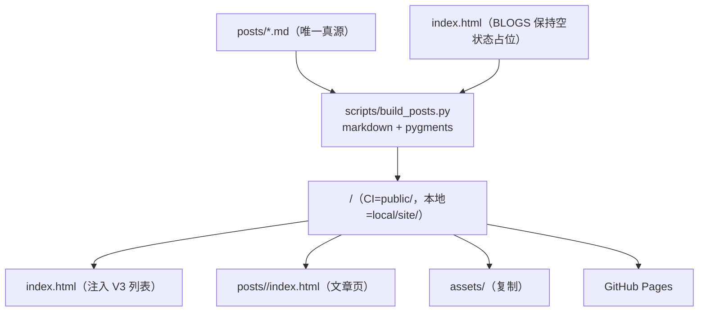

# 博客文章设计方案

> **created**: 2026-11-08 ｜ **last-change**: 2026-11-09 ｜ **status**: baseline

## 1. 简介

为站点补上写作能力：文章以 Markdown 文件为唯一真源，构建期生成静态文章页并把摘要列表注入首页 BLOGS 区块。排印沿用首页的宋体/Times 体系与杏色/暖黑双主题；运行时保持零第三方依赖，语法高亮与脚注全部在构建期完成。

设计来源：2026-11-08 会话中用户对高保真 demo（`local/blogs-md-demo.html`）的四项拍板——**首页列表选 V3（标题 + 摘要 + 日期）；正文 15px 与站一致；Markdown 需支持语法高亮与脚注；不展示标签**。已获人类确认，作为现行基线。

## 2. 索引

- 文档 ID：DESIGN-POSTS
- 所属总体：[系统总体设计](00-系统总体设计.md)
- 对应主题：BlogPosts
- 执行记录：[任务总账 (BlogPosts)](../task/index.json#BlogPosts)；首页区块变更见 [变更总账 (BlogHome)](../change/index.json#BlogHome)

## 3. 规范

### 3.1 目标

1. 写作即写 `posts/*.md`：frontmatter 声明元信息，正文即内容，提交后自动上线；
2. 文章页与首页同构：同一套 masthead、主题、字体与颜色令牌，视觉上是同一个站；
3. 语法高亮与脚注在构建期内联为静态 HTML，浏览器端零新增脚本与请求；
4. 生成物不入库：仓库只保存 md 源与构建脚本，部署时在 Actions 内现构建。

### 3.2 非目标

- 不做 RSS/订阅、评论、标签/归档/分类页（用户明确不要标签）；
- 不引入 CMS、前端框架或客户端 Markdown 渲染；
- 不做全文搜索——顶栏搜索栏（C013）仍为 UI 占位；
- 不承诺构建脚本支持全部 Markdown 方言，仅覆盖下方契约列出的语法子集。

### 3.3 约束

- 构建依赖为 `python3 + markdown + pygments`，文章含数学公式时另需 `matplotlib`（均只在构建期使用，不进运行时）；
- 页面在 `file://` 与 HTTP 下均可直接打开（文章页资源用相对路径 `../../`）；
- 构建脚本不访问网络、不写入 `posts/` 源目录；输出目录由参数指定（本地默认 `local/`，CI 用 `public/`）；
- 站点不得包含 secrets 或追踪脚本。

### 3.4 输入输出契约

- 输入：`posts/<slug>.md`，文件名即 slug（语义化连字符，建议 `YYYY-MM-DD-主题`）；
- frontmatter（起始 `---` 块）：`title`（必填）、`date`（必填，`YYYY-MM-DD`）、`summary`（必填，列表摘要，≤ 96 字）；`tags` 等其余键解析后忽略、不渲染；
- 正文语法子集：`#`~`####` 标题、段落、粗斜体、行内代码、围栏代码块（附语言名触发高亮）、有序/无序列表、引用、链接、表格、分隔线、脚注（`[^id]` / `[^id]: …`）、图片（外链）、数学公式（行内 `$…$` 与整行 `$$…$$`，构建期预渲染为内联 SVG，见 4.2 规则 14）；
- 输出：`<out>/posts/<slug>/index.html`、`<out>/index.html`（BLOGS 注入后）、`<out>/assets/`（整体复制）；
- 失败条件：缺 frontmatter、缺必填键、`date` 非法、`summary` 超长、任何数学公式渲染失败（报出公式原文，不静默降级）；围栏代码块语言不可高亮时按普通代码块降级（不失败）。

## 4. 设计详情

### 4.1 架构与行为

- 首页 `index.html` 是静态真源：仓库内 BLOGS 区块**永远是空状态占位**，构建期仅对输出副本做注入替换，源文件不被污染；
- 文章页模板从 `index.html` 现场抽取 `<head>`、`.page-art`、`.masthead`、`.foot` 片段并重写资源前缀（`assets/` → `../../assets/`、字标链接 → `../../`），保证与首页单源同构；`<h1>` 从字标让位给文章标题，字标降为普通链接；
- 本地预览：`python3 scripts/build_posts.py --out local/site` 后直接打开产物（依赖装在 `local/venv`，不污染系统环境）。

### 4.2 核心业务规则

<!-- @topic: BlogPosts -->

1. **单一真源**：文章内容只存在于 `posts/*.md`；生成的 HTML 一律不入库、不手改；
2. **frontmatter 契约**：`title`/`date`/`summary` 三键必填，缺失即构建失败并报出文件名；`tags` 解析后丢弃，任何页面不展示标签；
3. **URL 与排序**：文章地址为 `/posts/<slug>/`；首页列表与上一篇/下一篇均按 `date` 倒序，同日按 slug 字典序稳定排序；
4. **首页 BLOGS 列表（V3）**：每项为「标题链接 + 两行内摘要 + `YYYY-MM` 日期」，摘要 `summary` 为 frontmatter 原文（不截断正文）；条目间以发丝线分隔，最多展示 5 篇，其后不再显示计数；无文章时保留现行羽毛笔 + `COMING SOON` 空状态；
5. **文章页排印**：正文 15px / 行高 1.85 与首页一致；正文 `#`/`##` 均映射为 h2（20px / 700，行高 1.45），标题前由 CSS counter 输出两位序号 `01 /`（Times 数字、强调橘、0.8em、400），`###` 为 h3（17px / 700 墨色），`####` 为 h4（15.5px / 700 次级墨）；层级以字号、字重与 h2 序号表达，不画分隔线；文章标题为 h1（22px / 700），日期行 13px Times；
6. **代码高亮**：构建期由 Pygments 输出 token ``，配色为站点色板的双色映射——关键字/数字/内建名为强调橘（`--accent`），字符串/类型名为次级墨（`--ink-soft`），注释为浅墨（`--ink-faint`）——深浅主题通过同一组令牌自动适配，无客户端高亮脚本；代码块左上角静态显示围栏语言（C018；自定义 formatter 写入 `data-language` 与 `.code-lang`，无语言回退 `text`，11px 等宽浅墨，不依赖 JS）；每行行首内联行号（C018；等宽小号浅墨、固定 1.7em 列宽右对齐、距左边框 8px、`user-select:none` 不参与复制、`aria-hidden="true"` 不进入辅助技术阅读顺序，默认 `opacity:0`，鼠标悬停、键盘聚焦或触屏轻触代码块时 160ms 淡入，点按外部或移出后隐藏，打印时强制显示），横向溢出时使用 10px 透明轨道 + 4px 强调色胶囊滑块的自定义滚动条，悬停加深为强调色；不支持 `::-webkit-scrollbar` 的浏览器（Firefox）降级为 `scrollbar-width:thin` + `scrollbar-color`；代码块右上角由 `main.js` 渐进增强创建复制按钮（禁用 JS 时不出现），复制时克隆代码节点并移除 `.linenos` 行号，成功后按钮切换为对勾 1.6s，Clipboard API 失败回退 `execCommand`；
7. **脚注**：markdown `footnotes` 扩展渲染；正文上标为 Times 数字 + 强调色，文末脚注区 13px 次级墨、发丝上边线，含 `↩` 回跳链接；
8. **表格/引用/分隔线**：沿用首页令牌——表头小号大写浅墨、行间发丝线；引用为橘色左线 + 次级墨、不斜体（中文伪斜体不可用）；`---` 渲染为 48px 居中发丝线；
9. **相对路径与缓存版本**：文章页内一切站内资源以 `../../` 前缀引用；`?v=` 版本串从首页 `index.html` 解析并透传，两页永远一致；
10. **构建确定性**：同输入必得同输出（排序稳定、不写时间戳）；构建不访问网络；
11. **文章页导航**：页脚为「← 上一篇（有则显示）/ 返回首页」；「上一篇」为发布日期更早的一篇（即日期倒序列表中的下一项，C023），最早的一篇不显示；无下一篇入口；不展示标签；
12. **降级**：禁用 JavaScript 时文章完整可读（静态 HTML），仅损失主题切换、搜索占位与年份更新；顶栏搜索在文章页行为与首页一致（UI 占位）；
13. **字标行为**：文章页字标链接回首页（`../../`）；首页字标回顶逻辑仅对 `href="#top"` 生效，不作用于文章页；
14. **数学公式（C015）**：正文在 markdown 渲染前先保护围栏代码块与行内代码，再提取整行 `$$…$$` 与行内 `$…$` 公式，逐个经 matplotlib mathtext 渲染为内联 SVG——剥离 xml 声明与 metadata、pt 尺寸换算 px、fill 改写为 `currentColor`，行内包 `.md-math`（颜色取 `var(--ink)`、垂直居中对齐正文），整行包 `.md-math-block`（居中、窄屏 `max-width: 100%` 等比收缩）。内联 SVG 卫生（C022）：剥离 matplotlib 自带的 `<style>`（内联 SVG 的样式表在 HTML 中作用于整页，会把顶栏与复制按钮图标的 `stroke-linecap` 改为 `butt`）、透明背景矩形与 `figure_1`/`text_1` 等分组 id；字形 `<path>` 按 id 去重，收拢到文章页唯一的零尺寸 `.md-math-defs` 隐藏 SVG（`aria-hidden`，非 `display:none`），公式内只保留 `<use>` 引用，整页 id 唯一；同 id 字形定义不一致即构建失败。每个公式包裹层带 `role="img"` 与 TeX 原文 `aria-label` 作为替代文本。任何公式渲染失败即构建失败并报出原文；无公式文章不触发 matplotlib 依赖、产物不变；代码块内的 `$` 不参与公式解析。公式字体集固定为 STIX 衬线（C017；Times 风格，随 matplotlib 内置分发，不依赖系统字体），与正文 Times New Roman + 宋体同一排印体系。
15. **切页过渡（C016）**：首页列表标题、文章页「上一篇 / 返回首页」与字标返回首页为显式过渡链接（`data-page-transition`）：点击后内容层以 200ms ease 淡出并上移 8px，再执行站内导航；文章页（`body.post-page`）的正文与页脚在加载时以 560ms 曲线自下方 14px 淡入归位（页脚延迟 80ms）。顶栏与两侧字符画在两页同构，保持静止不参与过渡；修饰键点击、非左键、新窗口、下载与同页锚点保持浏览器默认行为；过渡不因 reduced-motion 关闭（与首页入场一致）；禁用 JavaScript 时退回普通整页导航。
16. **文章页内容列背景模糊带（C019）**：文章页在根层级输出 `.article-blur` 固定装饰层（`aria-hidden="true"`、`pointer-events:none`），宽度为 `--measure` 内容列左右各外扩 40px、水平居中；`backdrop-filter: blur(1px)`，左右 72px 多段羽化淡出。层位于两侧字符画之上、正文之下（`z-index:0`，`.page` 为 `z-index:1`），列外字符画保持清晰；首页产物不输出该层，打印时隐藏。C020 起移除原先叠加的 55% 纸面提亮，装饰层背景透明，浅色主题不再出现近白色块。

### 4.3 验证与实现情况

- 交付载体：T02（`docs/devel/task/T02.json`）；
- 构建回归：`node tests/posts.test.cjs` 覆盖——源 `index.html` 占位不被污染、产物列表为 V3 结构与排序、文章页标题/日期/高亮 token/脚注回跳、资源相对路径与 `?v=` 透传、双主题令牌、390px 无横向滚动；C015 起另覆盖公式内联 SVG 数量、无原始 `$` 残留与双主题公式颜色；C017 起校验公式字形为 STIX 衬线且不含 DejaVuSans；C018 起校验每个代码块行号数与代码行数一致、行号默认 `opacity:0` 且距左边框 9px、悬停淡入/移出归零、触屏轻触显示且点按外部隐藏、语言标签与围栏语言一致且位于左上角、行号列样式、滚动条伪元素尺寸/颜色、390px 代码块内部横向滚动，以及复制按钮的位置/标签/复制文本剔除行号/对勾复位；C019 起校验文章页存在 `.article-blur`（fixed、宽 656px、z-index 0、`blur(1px)`、72px mask 羽化），C020 起另校验其背景为透明 `rgba(0,0,0,0)`，且首页产物不含该层；C021 起校验 h2 20px、h3 17px、h4 15.5px，8 个 h2 均带 `counter(section, decimal-leading-zero)` 序号且为强调色 Times 数字；C022 起校验文章页无 `<style>`、整页 id 唯一且所有 `href="#…"` 可解析、`.md-math-defs` 唯一且 0×0、全部公式带 `role=img` 与非空 `aria-label`、共享字形可渲染，以及顶栏搜索/主题与复制按钮图标线帽保持 `round`；C023 起以仓库外临时目录分别构建两篇文章与含反斜杠标题的文章，校验较新一篇的「上一篇」指向较早一篇、最早一篇不显示上一篇、仓库外 `--out` 正常结束，以及标题/摘要中的 `\U`、`\1` 等反斜杠原样写入 `<title>` 与 description；
- 切页过渡回归：`node tests/page-transition.test.cjs` 覆盖——离场类与内容层透明度/位移、220ms 后导航至文章页、文章正文与页脚入场动画、修饰键点击不拦截、reduced-motion 下过渡仍保留；C025 起导航完成改为轮询判定（路径、`readyState` 与目标节点），入场终态在 `getAnimations()` 全部 `finished` 后读取，不再依赖固定等待时长；
- 视觉验收：构建产物在 1440px 与 390px 视口人工核对浅/深两主题；
- 未交付：RSS、标签/归档页、全文搜索（见非目标）。

### 4.4 规则演进

| 编号 | 类型 | 简介 | 规则演进 |
|---|---|---|---|
| [T02](../task/T02.json) | Task | 博客文章体系 | 新增 md→静态页构建（高亮/脚注，无标签）与首页 V3 摘要列表；仓库首页保持空状态真源，产物不入库 |
| [C015](../change/C015.json) | Change | 博客文章数学公式构建期渲染为内联 SVG | 正文语法子集新增行内 `$…$` 与整行 `$$…$$` 公式，构建期经 mathtext 预渲染为 currentColor 内联 SVG（双主题自适应），构建依赖增加 matplotlib，公式渲染失败为构建失败条件 |
| [C016](../change/C016.json) | Enhancement | 博客列表点击切换文章页过渡动画 | 博客列表与文章页站内导航新增切页过渡：内容层 200ms 淡出上移后导航，文章页正文与页脚 560ms 自下方淡入归位；顶栏与字符画保持静止；过渡不随 reduced-motion 关闭 |
| [C017](../change/C017.json) | Enhancement | 数学公式字体改为 STIX 衬线 | 公式渲染字体集由默认 DejaVu Sans 改为 STIX 衬线，与正文 Times New Roman + 宋体统一；字形随 matplotlib 内置分发，CI 与本地产物一致 |
| [C018](../change/C018.json) | Enhancement | 代码块语言标签、行号、滚动条与复制按钮 | 代码块左上角静态显示围栏语言；行号距左边框 8px、默认隐藏，悬停/键盘聚焦/触屏轻触时淡入；横向滚动条改为纸面风格细胶囊滑块，Firefox 以 thin/scrollbar-color 降级；右上角新增复制按钮，复制内容剔除行号，成功后短暂切换对勾 |
| [C019](../change/C019.json) | Enhancement | 文章页内容列背景模糊带 | 文章页根层级新增 `.article-blur` 固定层：内容列左右各外扩 40px，1px 高斯模糊 + 55% 纸面提亮，左右 72px 羽化淡出；列外字符画保持清晰，首页不出现、打印隐藏 |
| [C020](../change/C020.json) | BugFix | 移除文章页模糊带白色提亮层 | 去掉 `.article-blur` 的 55% 纸面提亮，只保留 1px 背景模糊与 72px 羽化，消除浅色主题下内容列背后的近白色块 |
| [C021](../change/C021.json) | Enhancement | 文章标题字号阶梯与 h2 序号 | h2 提升到 20px/700 并加两位强调色序号（CSS counter，不写正文），h3 17px/700 墨色，h4 15.5px/700 次级墨，解决标题与正文难分辨 |
| [C022](../change/C022.json) | BugFix | 数学公式内联 SVG 样式泄漏、重复 id 与替代文本 | 公式 SVG 剥离全局 `<style>`、背景矩形与分组 id，字形定义按 id 收拢为每页一份共享 defs，整页 id 唯一；公式包裹层补 `role=img` + TeX `aria-label` |
| [C023](../change/C023.json) | BugFix | 文章页「上一篇」方向与构建脚本转义 | 「上一篇」改为指向发布日期更早的一篇（原实现指向更新的一篇，最新文章反而没有上一篇）；标题/摘要写入页头时不再被正则替换解析反斜杠；`--out` 指向仓库外时构建正常结束 |
| [C025](../change/C025.json) | BugFix | 切页过渡测试偶发失败与文档失真 | 切页过渡回归改为等待导航完成与入场动画 `finished`；部署指南补 `matplotlib` 依赖、改正示例文章路径与 reduced-motion 说明；CHANGELOG 分类与代码注释同步现状；业务规则不变 |

### 4.5 参考资料

- python-markdown `extra`（表格/围栏代码）、`footnotes` 扩展与 `codehilite`（Pygments）的输出结构；
- 用户确认依据：`local/blogs-md-demo.html` 高保真 demo 及 2026-11-08 会话拍板（V3 / 15px / 高亮 + 脚注 / 无标签）；
- 首页排印与令牌：[博客首页设计方案](01-博客首页.md)。
