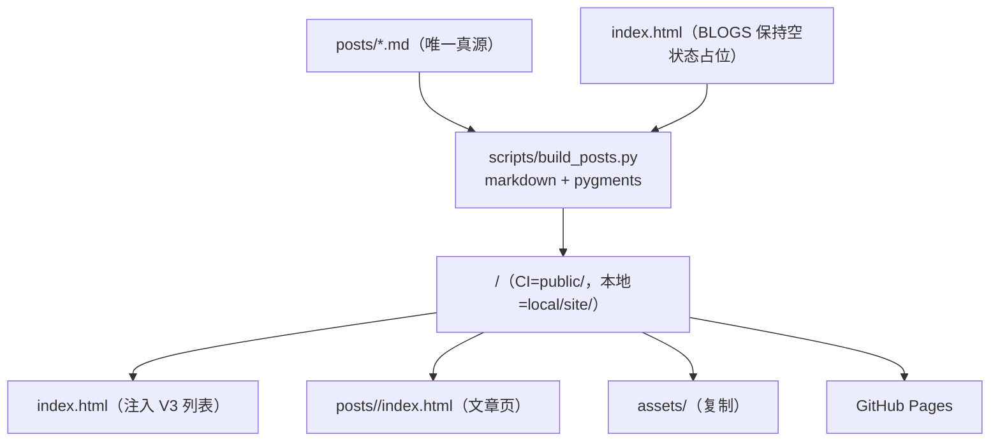

# 博客文章设计方案

> **created**: 2026-11-08 ｜ **last-change**: 2026-11-08 ｜ **status**: baseline

## 1. 简介

为站点补上写作能力：文章以 Markdown 文件为唯一真源，构建期生成静态文章页并把摘要列表注入首页 BLOGS 区块。排印沿用首页的宋体/Times 体系与杏色/暖黑双主题；运行时保持零第三方依赖，语法高亮与脚注全部在构建期完成。

设计来源：2026-11-08 会话中用户对高保真 demo（`local/blogs-md-demo.html`）的四项拍板——**首页列表选 V3（标题 + 摘要 + 日期）；正文 15px 与站一致；Markdown 需支持语法高亮与脚注；不展示标签**。已获人类确认，作为现行基线。

## 2. 索引

- 文档 ID：DESIGN-POSTS
- 所属总体：[系统总体设计](00-系统总体设计.md)
- 对应主题：BlogPosts
- 执行记录：[任务总账 (BlogPosts)](../task/index.json#BlogPosts)；首页区块变更见 [变更总账 (BlogHome)](../change/index.json#BlogHome)

## 3. 规范

### 3.1 目标

1. 写作即写 `posts/*.md`：frontmatter 声明元信息，正文即内容，提交后自动上线；
2. 文章页与首页同构：同一套 masthead、主题、字体与颜色令牌，视觉上是同一个站；
3. 语法高亮与脚注在构建期内联为静态 HTML，浏览器端零新增脚本与请求；
4. 生成物不入库：仓库只保存 md 源与构建脚本，部署时在 Actions 内现构建。

### 3.2 非目标

- 不做 RSS/订阅、评论、标签/归档/分类页（用户明确不要标签）；
- 不引入 CMS、前端框架或客户端 Markdown 渲染；
- 不做全文搜索——顶栏搜索栏（C013）仍为 UI 占位；
- 不承诺构建脚本支持全部 Markdown 方言，仅覆盖下方契约列出的语法子集。

### 3.3 约束

- 构建依赖仅 `python3 + markdown + pygments`（构建期使用，不进运行时）；
- 页面在 `file://` 与 HTTP 下均可直接打开（文章页资源用相对路径 `../../`）；
- 构建脚本不访问网络、不写入 `posts/` 源目录；输出目录由参数指定（本地默认 `local/`，CI 用 `public/`）；
- 站点不得包含 secrets 或追踪脚本。

### 3.4 输入输出契约

- 输入：`posts/<slug>.md`，文件名即 slug（语义化连字符，建议 `YYYY-MM-DD-主题`）；
- frontmatter（起始 `---` 块）：`title`（必填）、`date`（必填，`YYYY-MM-DD`）、`summary`（必填，列表摘要，≤ 96 字）；`tags` 等其余键解析后忽略、不渲染；
- 正文语法子集：`#`~`####` 标题、段落、粗斜体、行内代码、围栏代码块（附语言名触发高亮）、有序/无序列表、引用、链接、表格、分隔线、脚注（`[^id]` / `[^id]: …`）、图片（外链）；
- 输出：`<out>/posts/<slug>/index.html`、`<out>/index.html`（BLOGS 注入后）、`<out>/assets/`（整体复制）；
- 失败条件：缺 frontmatter、缺必填键、`date` 非法、`summary` 超长、围栏代码块语言不可高亮时按普通代码块降级（不失败）。

## 4. 设计详情

### 4.1 架构与行为

- 首页 `index.html` 是静态真源：仓库内 BLOGS 区块**永远是空状态占位**，构建期仅对输出副本做注入替换，源文件不被污染；
- 文章页模板从 `index.html` 现场抽取 `<head>`、`.page-art`、`.masthead`、`.foot` 片段并重写资源前缀（`assets/` → `../../assets/`、字标链接 → `../../`），保证与首页单源同构；`<h1>` 从字标让位给文章标题，字标降为普通链接；
- 本地预览：`python3 scripts/build_posts.py --out local/site` 后直接打开产物（依赖装在 `local/venv`，不污染系统环境）。

### 4.2 核心业务规则

<!-- @topic: BlogPosts -->

1. **单一真源**：文章内容只存在于 `posts/*.md`；生成的 HTML 一律不入库、不手改；
2. **frontmatter 契约**：`title`/`date`/`summary` 三键必填，缺失即构建失败并报出文件名；`tags` 解析后丢弃，任何页面不展示标签；
3. **URL 与排序**：文章地址为 `/posts/<slug>/`；首页列表与上一篇/下一篇均按 `date` 倒序，同日按 slug 字典序稳定排序；
4. **首页 BLOGS 列表（V3）**：每项为「标题链接 + 两行内摘要 + `YYYY-MM` 日期」，摘要 `summary` 为 frontmatter 原文（不截断正文）；条目间以发丝线分隔，最多展示 5 篇，其后不再显示计数；无文章时保留现行羽毛笔 + `COMING SOON` 空状态；
5. **文章页排印**：正文 15px / 行高 1.85 与首页一致；正文 `#`/`##` 均映射为 h2（17.5px / 700），`###` 为 h3（15.5px / 次级灰），层级只用字号与字重表达，不画编号与分隔线；文章标题为 h1（22px / 700），日期行 13px Times；
6. **代码高亮**：构建期由 Pygments 输出 token ``，配色为站点色板的双色映射——关键字/数字/内建名为强调橘（`--accent`），字符串/类型名为次级墨（`--ink-soft`），注释为浅墨（`--ink-faint`）——深浅主题通过同一组令牌自动适配，无客户端高亮脚本；
7. **脚注**：markdown `footnotes` 扩展渲染；正文上标为 Times 数字 + 强调色，文末脚注区 13px 次级墨、发丝上边线，含 `↩` 回跳链接；
8. **表格/引用/分隔线**：沿用首页令牌——表头小号大写浅墨、行间发丝线；引用为橘色左线 + 次级墨、不斜体（中文伪斜体不可用）；`---` 渲染为 48px 居中发丝线；
9. **相对路径与缓存版本**：文章页内一切站内资源以 `../../` 前缀引用；`?v=` 版本串从首页 `index.html` 解析并透传，两页永远一致；
10. **构建确定性**：同输入必得同输出（排序稳定、不写时间戳）；构建不访问网络；
11. **文章页导航**：页脚为「← 上一篇（有则显示）/ 返回首页」；无下一篇入口；不展示标签；
12. **降级**：禁用 JavaScript 时文章完整可读（静态 HTML），仅损失主题切换、搜索占位与年份更新；顶栏搜索在文章页行为与首页一致（UI 占位）；
13. **字标行为**：文章页字标链接回首页（`../../`）；首页字标回顶逻辑仅对 `href="#top"` 生效，不作用于文章页。

### 4.3 验证与实现情况

- 交付载体：T02（`docs/devel/task/T02.json`）；
- 构建回归：`node tests/posts.test.cjs` 覆盖——源 `index.html` 占位不被污染、产物列表为 V3 结构与排序、文章页标题/日期/高亮 token/脚注回跳、资源相对路径与 `?v=` 透传、双主题令牌、390px 无横向滚动；
- 视觉验收：构建产物在 1440px 与 390px 视口人工核对浅/深两主题；
- 未交付：RSS、标签/归档页、全文搜索（见非目标）。

### 4.4 规则演进

| 编号 | 类型 | 简介 | 规则演进 |
|---|---|---|---|
| [T02](../task/T02.json) | Task | 博客文章体系 | 新增 md→静态页构建（高亮/脚注，无标签）与首页 V3 摘要列表；仓库首页保持空状态真源，产物不入库 |

### 4.5 参考资料

- python-markdown `extra`（表格/围栏代码）、`footnotes` 扩展与 `codehilite`（Pygments）的输出结构；
- 用户确认依据：`local/blogs-md-demo.html` 高保真 demo 及 2026-11-08 会话拍板（V3 / 15px / 高亮 + 脚注 / 无标签）；
- 首页排印与令牌：[博客首页设计方案](01-博客首页.md)。
